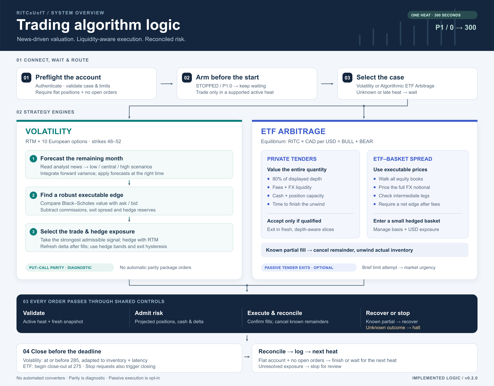

# RITCxUofT trading algorithms

A Python trading system for the **RITCx Volatility Trading** and **RITCx Algorithmic ETF Arbitrage** cases. One launcher detects the case, waits for the start, runs its strategy, reconciles the account, and optionally follows subsequent heats.

**Each heat lasts 300 seconds: one period, P1, with ticks 0–300.** `STOPPED · P1:0/300` means the simulator is waiting. Start the launcher before the judge starts the heat; no command or code change is needed at tick 1. `--rounds` counts separate heats, not periods or ticks.

The implementation incorporates the supplied research: news-driven option valuation and delta hedging, selective full-size tender evaluation, liquidity-aware execution, FX-aware basket trading, and post-heat analysis. Optional passive tender execution is available; put–call parity is a diagnostic scanner. The current version has been tested against local simulated APIs, **not yet validated for profitability on fresh competition heats**.

## Trading logic at a glance

[](docs/assets/trading-algorithm.png)

[Full-resolution image](docs/assets/trading-algorithm.png) · [Editable vector diagram](docs/assets/trading-algorithm.svg) · [Detailed algorithm explanation](docs/algorithms.md)

## Competition-day quick start

Supported runtime: **Python 3.10+ on macOS or Linux**. The trading code uses only the Python standard library. No NumPy, pandas, Excel, compiler, or pip installation is required. Native Windows execution is not supported by this launcher because its shared account lock uses POSIX file descriptors. The preserved official Windows REST scripts are separate reference material.

From this checkout on your Mac:

```sh
cd "/Users/samzhong/Documents/UofT/RITCxUofT"
python3 --version
python3 -m unittest discover -s tests -q
```

Prepare a private formal-competition profile **before** the first heat:

```sh
cp -n .env.contest.example .env.contest
chmod 600 .env.contest
```

Edit `.env.contest` locally. For DMA, enter the **organizer-assigned API host/port, trader ID, and password**:

```dotenv
RIT_ENVIRONMENT=contest
RIT_API_KIND=dma
RIT_API_URL=http://ORGANIZER_HOST:ORGANIZER_DMA_PORT/v1
RIT_USERNAME=YOUR_ASSIGNED_TRADER_ID
RIT_PASSWORD=YOUR_PASSWORD
```

`ORGANIZER_HOST` and `ORGANIZER_DMA_PORT` are placeholders. Use HTTPS if provided by the organizers. Browser login ports, Windows client login ports, and API ports are different; do not copy a port from a website table or starter script without confirming its purpose. Your existing `.env` has been preserved for the mock/practice connection.

First perform the read-only check:

```sh
python3 -m ritcx --config .env.contest --contest --preflight
```

A stopped tick-0 case can pass preflight. That means the account and case settings passed the checks; the heat has not started. Then arm **one heat**:

```sh
python3 -m ritcx --config .env.contest --contest --trade --rounds 1 --max-seconds 1800
```

This waits up to the session deadline, follows one eligible heat, closes its positions, and exits. The 1,800 seconds includes waiting; it does **not** change the 300-second heat length. Keep the terminal open and the Mac awake. If desired, prefix the trading command with `caffeinate -i` on macOS.

For a sequence of heats, use the announced heat count and a sufficient waiting deadline. For example:

```sh
python3 -m ritcx --config .env.contest --contest --trade --rounds 20 --max-seconds 14400
```

Here `20` and `14400` are examples, not the event schedule. If both cases share the configured server, the launcher switches strategies automatically. If organizers assign separate API endpoints, prepare one profile per endpoint and run the appropriate profile for the scheduled case. The launcher does not discover or switch servers.

## What you should see

| Console output | Meaning / action |
|---|---|
| `PREFLIGHT PASSED (read-only)` | Authentication, case parameters, limits, flat inventory, and no open orders passed. No orders were sent. |
| `ARMED` then `WAITING` | Ready and waiting for a recognized active heat. `STOPPED P1:0/300` is normal. |
| `STARTING` | The launcher selected the ETF or volatility bot. |
| `TRADING tick=…/300 nlv=… fines=… positions=…` | Periodic account status. NLV is current simulator account value. No signal can legitimately mean no orders. |
| `CLOSING` | Reducing inventory before the end, after a stop request, or after the loss threshold. |
| `finished_flat`, `final_reconciliation`, `HEAT_FINISHED` with exit code 0 | Fresh account reads show no instrument inventory/open orders, with less than one USD unit permitted for FX rounding. CAD profit stays in the account. |
| `SESSION_FINISHED` | The launcher is no longer armed. Restart it if more heats remain. |
| `STOPPED_AFTER_ERROR` / `reconciliation_unavailable` | Inspect the simulator and JSONL logs. Do not restart into unresolved inventory or orders. |

A new launcher can join an already-active heat before tick 250. From tick 250 onward, it waits for a new heat. The runner detects case/period changes, observed tick resets, and active-to-stopped transitions, including progress reported by its child bot. It cannot identify a reset the server never exposes between observations.

### Timing and operating limits

These are the **default bot policies**, distinct from the published maximum allowances.
Volatility uses `buffered`; select `--volatility-strategy baseline` for the original smaller policy:

| Policy | Volatility | ETF |
|---|---:|---:|
| Heat length | 300 ticks | 300 ticks |
| Last new entries | Before 270 | Tenders before 250; baskets before 260 |
| Begin proactive close-out | At or before 285; earlier for larger books/slower cycles | 275 |
| Loss-triggered close-out, relative to first account snapshot | −6,000 | −2,500 CAD |
| Normal position sizing | Up to 100 options per entry, clipped for edge/risk; at most 40 per close leg | 500 ETF/basket units per entry; at most 5,000 open basket units |
| Internal inventory caps | 1,000 gross / 800 absolute net option contracts; 45,000 RTM shares | 250,000 weighted gross / 200,000 absolute weighted net equity units; 8,000,000 combined absolute cash units |
| Additional control | 1,200-delta hedge trigger; new entries reserve 25% of stressed-risk capacity | Tender quantity ≤100,000; check every intermediate basket position and settlement cash |

The PDFs allow terminal settlement; these bots choose early liquidation. Loss thresholds trigger an attempt to close and are **not guaranteed maximum losses**. Quotes can move and API failures can prevent completion.

## Practice and read-only observation

### Run a local 300-second Volatility simulation now

**November 19 strategy update:** [case audit, public research, and new policy details](docs/volatility-research-2026-11-19.md).
**Latest revision:** [`buffered` reduces repeated entries and risk closes](docs/volatility-buffered-followup.md)
by leaving more room below the entry risk limits. Its position caps are the same as `scaled`.
`buffered` is now the default for the launcher, standalone volatility bot, and local dashboard.
To watch the new forecast-based sizing and execution in a scenario based on the published case:

```sh
cd "/Users/samzhong/Documents/UofT/RITCxUofT"
caffeinate -i python3 -u -m ritcx.mock --scenario case --policy buffered
```

It runs for 300 real seconds. `buffered` permits larger positions; use `--policy buffered_small`
to keep the original 100-contract position cap, or `--policy baseline` for the original strategy.
Add `--seed 1459556188` to repeat a path or `--speed 20` for an accelerated check.
The case scenario's maker lag and forecast-error distribution remain assumptions, so its
P&L is not a prediction of competition performance. A flat initial P&L can be correct:
the initial maker and analyst volatility agree, and the first forecast arrives at tick 37.

To watch the strategy without waiting for the Rotman practice server:

```sh
cd "/Users/samzhong/Documents/UofT/RITCxUofT"
caffeinate -i python3 -m ritcx.mock
```

This starts the **case scenario with the buffered policy** immediately and runs for **300 wall-clock seconds**, updating a
terminal dashboard once per simulated second. It shows net P&L, realized and
unrealized P&L, commissions, delta fines, drawdown, positions, recent fills, and
a P&L chart. It also explains waiting decisions such as `no edge after costs` or
`risk capacity / no admissible entry`. Net P&L already includes fees and fines. The strategy can close early;
the dashboard continues through tick 300. On non-Mac systems omit `caffeinate -i`.
Use a terminal window at least 80 columns wide and 24 rows tall; taller windows show more detail,
or add `--plain` for scrolling status updates every five simulated seconds.

Each run chooses a new random seed and displays it. To repeat the same scenario,
or run a 300-tick heat in about 30 seconds:

```sh
python3 -m ritcx.mock --seed 7
python3 -m ritcx.mock --seed 7 --speed 10
python3 -m ritcx.mock --scenario stress --seed 7
python3 -m ritcx.mock --scenario standard --policy strict_edge --seed 7
```

The previous optimistic simulator is retained as `--scenario demo`; to reproduce
the earlier +$4,218.16 example use `--scenario demo --policy baseline --seed 7`. A seed identifies the
same market only within the same scenario and simulator version.

The original local policies are `baseline` (the earlier small-position strategy), `strict_edge`
(entry edge >0.10 instead of >0.025), `wide_hedge` (1,000 instead of 500 delta), and
`half_size` (5-contract entries and a 50-contract cap instead of 10/100). Post-fill
hedges remain tight for these four policies. The new `scaled`/`scaled_small` and
`adaptive`/`adaptive_small` policies use a 1,200-delta band after entries and stronger
portfolio stress checks. `adaptive` tests current-sigma maker convergence;
`scaled` retains forecast-based remaining-variance valuation. Live selection is explicit:

```sh
python3 -m ritcx --practice --preflight --volatility-strategy buffered
caffeinate -i python3 -u -m ritcx --practice --trade --rounds 1 --max-seconds 1800 --volatility-strategy buffered
```

This practice command waits for an active server heat and sends simulated exchange orders.
The normal launcher without `--volatility-strategy` uses `buffered`. Use
`--volatility-strategy baseline` to restore the earlier small-position strategy,
or `--strategy baseline` when running `ritcx.volatility.bot` directly.

The local runner never reads `.env`, uses RIT credentials, opens a network
connection, or changes your practice account. Stop a separately armed practice
launcher with Ctrl-C if you no longer want it to trade when the server starts.
Ctrl-C in the local runner stops immediately and saves an **interrupted** report
with any remaining synthetic positions. Every run saves a JSON summary and a
JSONL event log under `logs/mock/`; paths are printed at exit.

**These are synthetic stress tests, uncalibrated to official RIT conditions.**
The runner reuses production trading, hedging, risk checks, reconciliation, and
the close-out threshold including observed cycle duration. Standard/stress modes
charge simulated time for every API request and order, then wait 0.6 seconds per
cycle for baseline (0.1 seconds for the new policies). The price path advances during those delays; orders fill at the arrival
quote. Accelerating wall time leaves simulated timing and outcomes unchanged.

| Assumption | Standard | Stress |
|---|---:|---:|
| Forecast error standard deviation, plus a shared bias with half that deviation | 4.5 volatility percentage points | 9 points |
| Forecast range half-width | 3 points | 2.5 points |
| Quote response time constant, sampled per week | 1–12 seconds | 0.5–8 seconds |
| Quote volatility innovation per tick | 0.3 points | 0.8 points |
| Time per API request | 15–55 ms | 60–180 ms |
| Additional order delay | 80–400 ms | 300–1,500 ms |

The market maker reacts to released forecasts and current volatility. For unknown
future weeks it reverts toward a 25% long-run estimate; the bot carries its latest
news estimate forward. Forecast ranges can miss the realized outcome. Prices use
Black–Scholes and a $0.02 spread with a nonnegative bid floor. RTM follows a
geometric Brownian path with four weekly volatility regimes. Forecast, quote,
price, and transport randomness are separated so policy comparisons share the
same exogenous market path. The clock and market move in one-second price steps;
subsecond request delays accumulate, but prices do not change within a tick.

Fills remain full-size, with no queue, market impact, partial fills, or randomly
injected outages. Published commissions, limits, and per-tick delta fines apply.
Remaining inventory settles at tick 300 without an extra commission. A trading
error stops new mutations but the local market continues to settlement; reports
retain the error, inventory at failure, and positions settled at expiry. An error
is never relabeled as success just because settlement clears inventory.

Run a reproducible comparison of all four policies on both scenarios:

```sh
python3 -m ritcx.mock_evaluate --seeds 30 --output reports/mock-evaluation.json
```

This evaluates **480 accelerated heats**: 30 seeds × 2 scenarios × 4 policies ×
2 disjoint seed sets (exploratory 0–29, held-out 10000–10029). Every policy sees the
same seeds. Reports include average/median/worst P&L, losses, drawdown, fees, fines,
failures, and paired changes versus baseline. Failed runs are retained. Policies
are fixed in advance; the command does not tune or deploy a winner.
See [the November 19 evaluation](docs/mock-evaluation.md) for results and limits.

Compare the new policies on the case assumptions and adverse sensitivity scenarios:

```sh
python3 -m ritcx.mock_evaluate --seeds 20 --scenarios case case_fast case_latency standard stress --policies baseline scaled_small scaled --exploratory-start 60000 --held-out-start 70000 --output reports/volatility-scaled-evaluation.json
```

This runs 600 accelerated synthetic heats. Reports include failures and source hashes;
rerunning the same seeds is a reproducibility check, not additional independent evidence.

### Connect to the official practice server

The existing `.env` is private and ignored by Git. For a fresh checkout, copy `.env.example` and enter your practice credentials. Its DMA URL is the previously used mock endpoint; confirm the assigned current endpoint before use.

```sh
python3 -m ritcx --practice --preflight
python3 -m ritcx --practice --trade --rounds 1 --max-seconds 1800
```

To observe a heat without submitting orders, omit `--trade`:

```sh
python3 -m ritcx --practice --rounds 1 --max-seconds 1800
```

Preflight exits immediately. Observation watches one heat. Both prohibit API mutations. `--trade` additionally requires `--practice` or `--contest` matching the profile. Environment variables with the documented `RIT_` names override the profile, including credentials and endpoint; clear stale exported values if the displayed endpoint is unexpected.

The event page recommends **Windows client REST** for stability and also provides DMA examples for Mac/browser users. This package supports both authentication schemes on its supported macOS/Linux runtime. For an organizer-approved reachable client REST endpoint, set `RIT_API_KIND=rest`, `RIT_API_KEY=…`, and the client API URL; keep `RIT_USERNAME` as the assigned account ID for the local lock. A REST API key is not the DMA password. This adapter is locally tested, not a claim of native Windows launcher support or a verified formal endpoint.

## Strategy controls

The default trades tenders and small ETF baskets. To focus exclusively on tenders:

```sh
python3 -m ritcx --practice --trade --no-baskets --rounds 1 --max-seconds 1800
```

Optional passive tender exits try a limit order for at most 0.75 seconds per slice, cancel the remaining quantity, reconcile any fills during cancellation, and switch to market orders after an incomplete passive attempt or as time becomes short:

```sh
python3 -m ritcx --practice --trade --passive-tenders --rounds 1 --max-seconds 1800
```

Qualify this option in fresh practice heats before using it in competition. Tender acceptance assumes market fees and ignores passive rebates, so it does not require earning a rebate to appear profitable. Passive quotes are best-effort: a moving market can make a limit order immediately marketable. There is no exchange-enforced post-only guarantee.

For debugging, the individual bots are also runnable. Use the launcher for competition operation:

```sh
python3 -m ritcx.volatility.bot --practice --watch
python3 -m ritcx.etf.bot --practice --watch
```

These examples are read-only. Never run an individual trading bot alongside the trading launcher. Both use a shared account lock on this computer; that lock cannot stop a different computer or unrelated program.

## Algorithms

**Volatility:** parse the actual analyst news and interest rate; build low/central/high forward-volatility scenarios; integrate variance over the remaining month; value the ten options at strikes 48–52 with Black–Scholes; compare fair value with executable ask/bid after fees and reserves. Select the strongest robust net edge. Hedge the actual portfolio with RTM, using quoted implied volatility for option deltas and the analyst estimate as a fallback. Use a hedge band and separate entry/exit thresholds to reduce churn. Put–call parity packages are priced after costs and logged as diagnostics; the bot does not execute those three-leg packages.

**ETF tenders:** check the entire tender size against a book with a 20% depth reserve, market fees, minimum profit, FX liquidity for the estimated net proceeds, post-acceptance cash/equity capacity, and a time budget for all unwind slices. Re-evaluate immediately before acceptance. After acceptance, refresh depth for each slice, reconcile fills, and hedge net USD exposure. The exit route is direct ETF liquidation; it does not depend on a converter or a hypothetical future fill.

**ETF baskets:** compare `RITC × CAD-per-USD` with `BULL + BEAR` using quantity-dependent equity and full-notional FX book prices. Trade only after round-trip commission allowances and a 0.15 CAD/unit residual edge. Check every intermediate subset of the three legs, including cash. A confirmed partial fill stops the remaining entry legs and initiates a reconciled unwind; an uncertain submission is never blindly retried. Net USD exposure includes cash plus the marked ETF position.

Basket trades retain convergence and execution risk. The case reserves converters for manual human use; this program blocks converter mutations and does not coordinate manual conversions. Avoid manual inventory changes while it runs.

See [algorithm details](docs/algorithms.md), [research-to-code mapping](docs/research-integration.md), and [source/rule notes](docs/sources.md).

## Stop, recover, and review

Press **Ctrl-C once** to request closing. Keep the terminal open until reconciliation completes. The launcher waits for its child to finish its close-out attempt. A network timeout, rejected order, changed heat, changed contract, or unresolved cancellation stops new trading and records the account state when readable. Only a confirmed partial fill with a confirmed cancelled remainder can be automatically recovered. The bot does not retry an uncertain POST.

If it stops with exposure, use the organizers’ authorized recovery procedure and a suitable algorithm to reconcile/close the account before restarting. There is no automatic resume into arbitrary existing positions. Ordinary ETF-case trades must remain algorithmic.

Every run writes timestamped JSONL files under `logs/`: session output plus a separate `volatility-…` or `etf-…` child log. Logs and private profiles are excluded from Git. `RIT_LOG_DIR` can point to a separate experiment folder. After practice, summarize the selected child logs:

```sh
python3 -m ritcx.analytics logs/etf-*.jsonl --output reports/etf-evaluation.json
python3 -m ritcx.analytics logs/volatility-*.jsonl --output reports/volatility-evaluation.json
```

Run a glob only after at least one matching log exists. The report excludes newly marked read-only runs and session logs, and reports incomplete runs separately. P&L is the change from first snapshot to the last observed/reconciled value; it is not necessarily the later official settlement. Compare fresh heats, retain losing/error runs, and avoid tuning only to the best result. Legacy logs lack an explicit execution-mode marker, so select them carefully.

## Repository layout

```text
ritcx/
  __main__.py, session.py       one CLI and heat lifecycle
  api.py, execution.py          transport, pacing, orders, fill reconciliation
  runtime.py                   profiles, audit files, shared account lock
  volatility/model.py, bot.py   valuation, news, risk, hedge loop
  etf/model.py, execution.py,
      bot.py                   tender/basket valuation and execution
  analytics.py, benchmark.py   offline heat evaluation and CPU measurement
references/
  official/                    unchanged PDFs, workbook, DMA/REST starter scripts
  volatility-decision-support.csv  your supplied CSV, unchanged
  notes/                       earlier workbook/VBA extraction
  manifest.json                source URLs and SHA-256 hashes
docs/                          algorithms, research mapping, rules, validation
reports/                       historical practice records and verification results
tests/                         model, HTTP, order lifecycle, and complete CLI tests
```

The original six root Python files have been replaced by the package. Do not use the old `session_runner.py`, `practice_bot.py`, or `etf_bot.py` commands. The official scripts retain their original third-party copyright and dependencies; they are reference files, not launch targets. The supplied CSV is a disconnected Excel template with cached errors, not historical market data or runtime input.

**Why Python:** the live loop is dominated by API requests and reconciliation. The pricing universe is only ten options. Keeping one standard-library implementation avoids a second build/runtime path; a C++ rewrite has no demonstrated end-to-end advantage here. See [validation and measured limitations](docs/validation.md).

## Official competition material

- [Event, setup, practice details, and scoring](https://www.rotman.utoronto.ca/faculty-and-research/education-labs/bmo-financial-group-finance-research-and-trading-lab/finance-research-and-trading-lab/events/ritcxuoft/)
- [Volatility case](https://rotmanfrtl.github.io/RITCx-Volatility%20Trading%20Case.pdf)
- [Algorithmic ETF case](https://rotmanfrtl.github.io/RITCx-Algorithmic%20ETF%20Arb%20Case.pdf)

The event scores each case at 50%, using heat ranks. Consistency across fresh heats matters more than the largest isolated profit. Organizer instructions and the live assigned contract parameters take precedence over archived examples.
