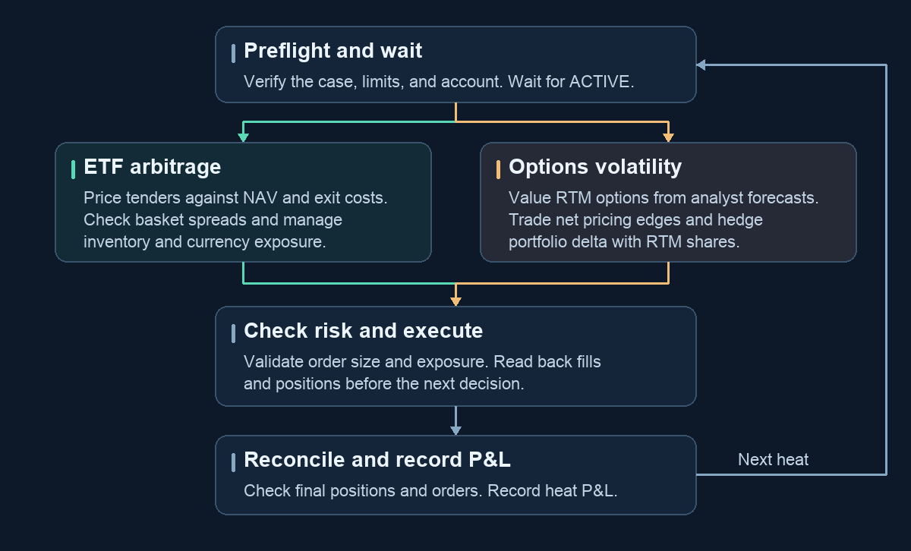

# RITCxUofT

StockMates built two Python trading bots for the Rotman Interactive Trader competition at the University of Toronto. The bots share a launcher that validates the simulator account, waits for each heat, and records P&L after reconciling fills, open orders, and positions.

- **ETF arbitrage** prices RITC tenders against the fund’s net asset value and expected exit costs. It also checks for executable basket arbitrage and manages inventory and currency exposure.
- **Options volatility** uses analyst forecasts and Black–Scholes to value RTM options, looks for mispricing after transaction costs, and hedges portfolio delta with RTM shares.

## Trading flow

[Algorithm design and detailed execution flow](docs/algorithms.md)

## Competition results

| Case | Heats with recorded P&L | Profitable heats | Average P&L per recorded heat |
| --- | ---: | ---: | ---: |
| ETF arbitrage | 8 of 8 | 6 of 8 | +44,394.63 |
| Options volatility | 7 of 8 | 7 of 7 recorded | +29,976.40 |

The ETF bot completed all eight heats and earned the higher average P&L. Options posted gains in all seven recorded finishes, but its average was lower and a simulator connection failure interrupted the fifth heat before the bot could close its positions. That heat is excluded from the options average.

These figures come from the bots’ reconciled heat logs for November 20, 2026. Official scoring uses heat ranks. [Competition format and scoring](https://www.rotman.utoronto.ca/faculty-and-research/education-labs/bmo-financial-group-finance-research-and-trading-lab/finance-research-and-trading-lab/events/ritcxuoft/)

## Documentation

- [Case debrief slides and explanations](docs/case-debrief.md)
- [Competition runbook](docs/competition-runbook.md)
- [ETF practice and replay evaluation](reports/etf-strategy-comparison-2026-11-19.md)
- [Options strategy evaluation](reports/volatility-buffered-replay/comparison.md)
- [Validation and tests](docs/validation.md)
