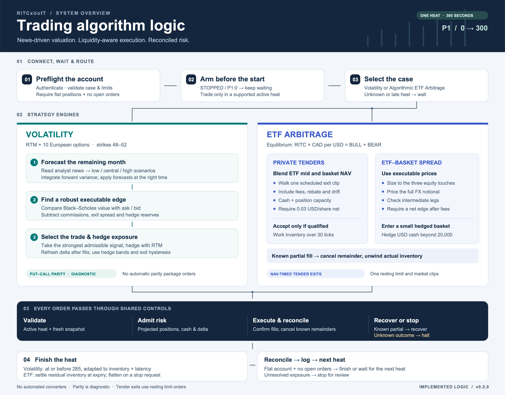

# Algorithm design and operating assumptions

The live entry point is `python3 -m ritcx`. Models are pure functions; bots choose actions; shared execution reconciles orders against server inventory. No model calls a converter. The algorithms target mechanisms described by the supplied cases, not price-history indicators.

[](assets/trading-algorithm.svg)

## Volatility valuation

For each option, `T = max(300 − tick, 0) / 3600` years. This matches the official Python support script: 20 simulated trading days per 300 seconds, 240 trading days per year. Use the interest rate announced by the server, with European non-dividend Black–Scholes pricing and 100 shares per contract.

News is sorted by its tick and ID, and future-dated records are ignored. “Next week” announcements are placed in the next 75-tick interval. A forecast never replaces current-week realized volatility early. Low/high endpoints and their midpoint form three scenarios. Remaining variance is integrated:

```text
sigma_effective² = sum(duration_in_interval × sigma_interval²) / remaining_ticks
```

Unannounced weeks carry forward the latest available range. This is an explicit modeling assumption, not knowledge of later realized volatility. Tick boundaries follow the existing simulator convention 0/75/150/225; the PDF’s prose and sample announcement table are inconsistent, so actual news timestamps remain authoritative.

The sole `buffered` policy uses the forecast-based valuation. Long entries use the low-volatility fair value minus the ask; short entries use the bid minus the high-volatility fair value. Deduct both option commissions, half the quoted spread as an exit reserve, and 0.04 premium units for hedging/uncertainty. Require another 0.04 premium units of edge. Desired tickets scale with edge, up to 100 contracts, and portfolio risk can clip them further. The bot selects the admissible order with the largest estimated total net edge. These are heuristics, not fitted optimal parameters.

The quote-implied-volatility solver uses bounded bisection. Implied volatility is used for the hedge delta, consistent with the original decision-support workbook’s intent; valuation uses analyst information. If quote IV is outside the numerical pricing interval, the hedge falls back to the current analyst estimate.

```text
portfolio_delta = RTM_shares + 100 × sum(option_contracts × option_delta)
hedge_change = −round(portfolio_delta)
```

A normal buffered hedge requires at least 1,200 delta units; option closes and confirmed partial fills force a tighter hedge. Inventory caps are 1,000 gross and 800 absolute net options, with 45,000 RTM shares. Admission checks bound quoted delta before hedging at 4,500 and current-sigma delta at 6,000. Reprice at three-standard-deviation spot moves over at least three seconds (or the observed cycle time if longer), using quoted/current sigma and ±25% volatility shocks. Stressed new-entry delta is limited to 4,875 before the intended hedge and 4,125 after it. Existing positions retain 6,500/5,500 holding thresholds, leaving room between entry and risk reduction to reduce repeated buying and closing. Spot jumps can still create exposure between API observations.

Entry and exit rules differ. Buffered closes an existing long once `fair_low − bid ≤ 0.035`, or a short once `ask − fair_high ≤ 0.035`. Risk violations can initiate reduction earlier. Emergency closes first relieve current delta excess, then compare projected hedge capacity and stress risk. If the desired stock hedge exceeds its cap, the bot clips that hedge and reduces options. New entries stop at 270. Close-out begins no later than 285, earlier according to remaining option tickets of at most 40 contracts, stock tickets of at most 10,000 shares, a reconciliation cycle, a three-second cycle floor, 1.5 times the slowest of the last 20 complete cycles, and five seconds of slack. Stop requests, confirmed partial fills, or a $6,000 loss trigger also initiate closing. Loss triggers do not guarantee maximum losses. Hedge execution refreshes the case and inventory; stale decisions refresh news/time too, and entries recheck the decision tick before submission.

Only buffered is implemented. The previous alternatives have been removed following the [volatility-only judge-scoring comparison](../reports/volatility-judge-rerun-2026-11-19.md). The trading logic, risk limits, and close-out behavior match the evaluated buffered revision.

At active tick 0, usable news may not yet exist. A flat account waits. Missing usable news while positions exist stops the algorithm for reconciliation rather than guessing a hedge model.

### Put–call parity scanner

For each strike K, the diagnostic scanner evaluates executable synthetic packages against discounted strike cash:

```text
rich synthetic: 100 × (call_bid − put_ask − stock_ask + K exp(−rT))
cheap synthetic: 100 × (stock_bid − call_ask + put_bid − K exp(−rT))
```

It subtracts round-trip commissions for both options and 100 RTM shares and requires a further $3 margin. Signals appear in `parity_scan`. They are not executed: this implementation’s close-out policy would otherwise need separate package ownership, financing, and multi-leg exit validation. A positive scan is not a verified executable profit.

## ETF tender model

A fixed-price BUY tender adds RITC inventory. A SELL tender reduces it. Each offer must have a valid price, a whole-share quantity up to 100,000 and at least two ticks remaining. Re-read the book, tick and positions before accepting. Include the tender price in the POST and confirm the signed change in the ETF position.

```text
NAV = (BULL mid + BEAR mid) / USD mid
fair = (RITC mid + NAV) / 2
edge per share = sign × (fair − tender price) − signed exit cost
```

The modeled exit clip is the larger of newly added inventory and 60,000 divided by the glide horizon, up to the ticket cap. Walk that clip against remaining external depth. An incomplete book uses half the spread plus 0.03 and the market fee. Blend the aggressive cost equally with the passive estimate, then add 0.02 for drift. The passive estimate is the positive part of half the spread less one cent, less the reported rebate. Inventory already offset by a tender earns the corresponding cost credit. Ordinary offers require 0.03 USD/share after costs. From tick 285, offers that create new inventory need 0.10 USD/share for settlement. New offers stop at 297.

Tender inventory equals RITC plus BULL when the two stock legs are equal. After acceptance, start or extend a declining inventory allowance. At neutral NAV the selected horizon is 30 ticks. The rate multiplier is `1 − sign(inventory) × (NAV − mid) / 0.10`, clipped to 0.25–2.5. A profitable tender blocked by risk temporarily accelerates the glide. A market clip reduces any deficit of at least 500 shares, capped by actual excess, the ticket limit and one per tick. A separate limit order rests until the next decision. Cancel its known remainder and reconcile its final fill and position before trading again. Ordinary market clips stop in the last eight ticks. Exchange settlement handles residuals.

The optional `--hold-to-close` cost contingency accepts at a 0.08 USD/share bar and carries the resulting inventory to settlement. `--loss-limit-cad` enables operator-selected early liquidation. The normal glide carries mark-to-market risk through reversals. See the paired replay, downside and practice observations in the [ETF evaluation](../reports/etf-strategy-comparison-2026-11-19.md).

## ETF basket and FX execution

While no tender or excess RITC needs attention, size a basket to the remaining external touch on each equity, at most 5,000 shares. Price the full ETF notional through the appropriate FX book and require 0.06 CAD/unit after three market fees. Given the 250,000 internal gross cap, reserving the published 200,000 weighted units for the largest tender leaves capacity for 12,500 four-unit pairs. Check all seven intermediate fill subsets, cash and both the published and server-reported weights. Refresh positions after each leg. A confirmed partial fill aborts the remaining legs and initiates a reconciled liquidation.

RITC settles in USD and basket constituents settle in CAD. The bot hedges USD cash at a 20,000-unit band with at most one normal FX clip per tick. On a stop request it flattens the equities and hedges residual currency to within one unit. Natural expiry requires a read-back of final positions, open orders and NLV.

## Execution and lifecycle

- Default transport is DMA Basic authentication; explicit client REST profiles use `X-API-Key`.
- Requests are paced; read-only HTTP 429 responses follow the supplied retry wait within the operating budget. Mutations are not automatically retried, including a POST rejected with 429.
- Every mutation checks the bound active case, period and monotonic tick. New order/tender submissions also enforce a decision age of at most two ticks. Cancelling a known order can proceed on older price data, but still requires the same active heat.
- A receipt is not a fill ledger. Known partial orders are cancelled by ID, reread to include cancellation races, compared with actual positions, and checked for residual open orders before a replacement.
- An ETF basket partial fill aborts later legs and closes known inventory. Volatility partial recovery hedges actual known inventory and enters close-out mode. Uncertain responses stop execution; the system cannot safely invent a fill amount.
- Preflight requires a flat start, validated securities/fees and sufficient live limits. Contracts or smaller limits outside the implemented assumptions cause a stop.
- A local account lock spans launcher and child. Child errors stop the session. Ctrl-C requests close-out and final reconciliation.

All strategy parameters in this document are initial operating choices. They require evaluation across independent randomized heats before increasing size or describing them as optimal.
