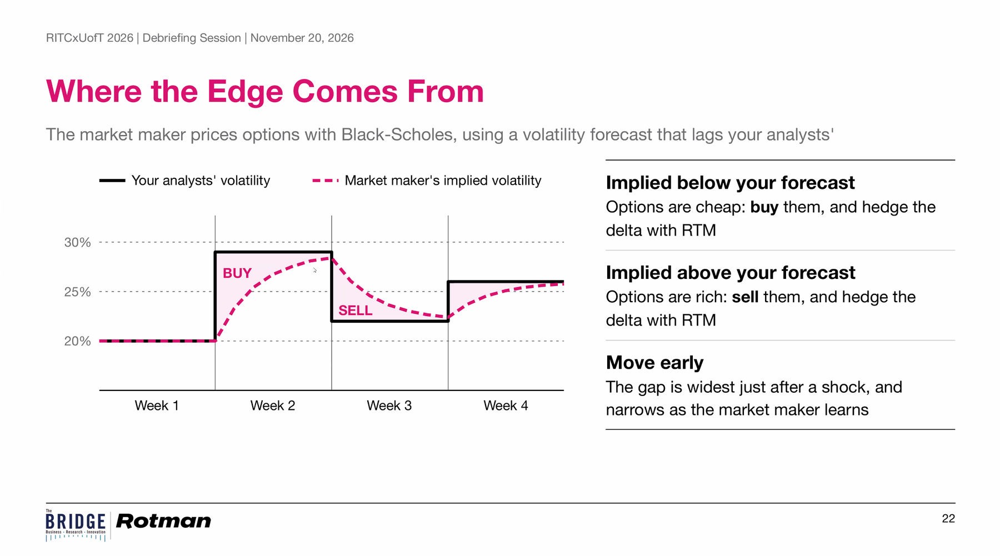
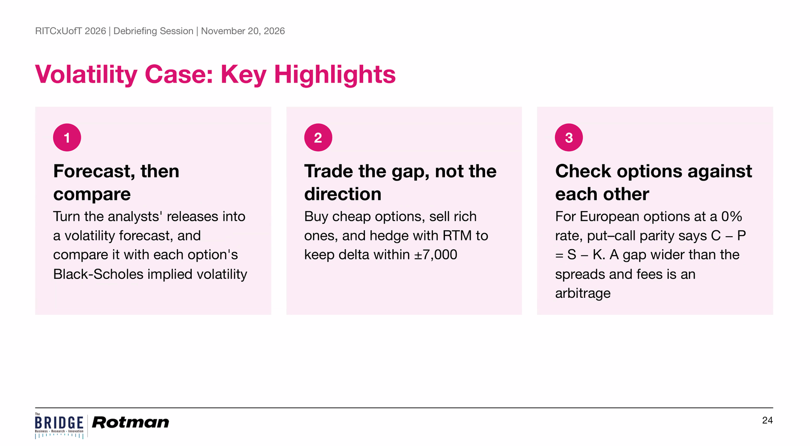
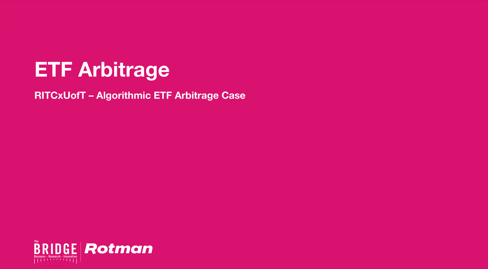
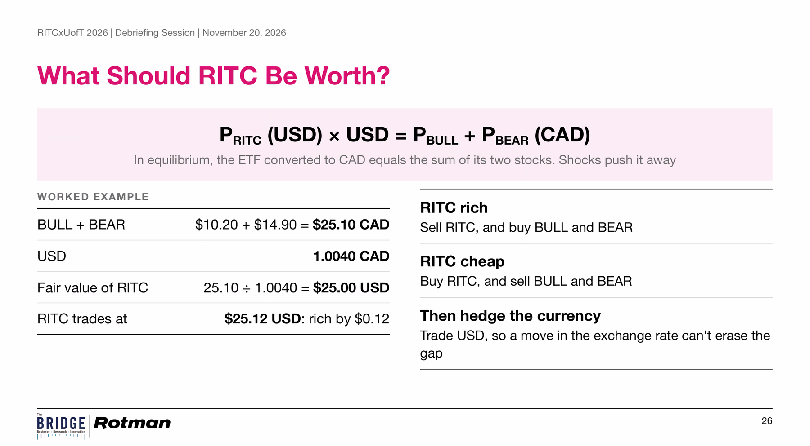
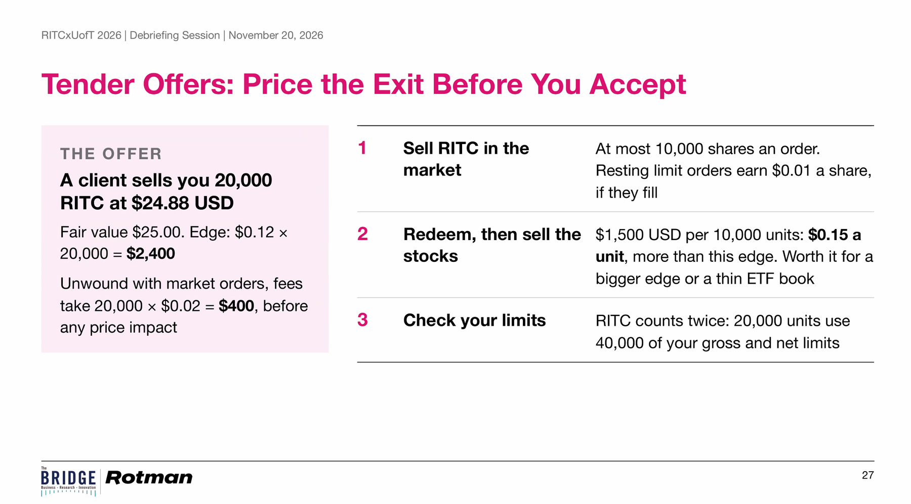
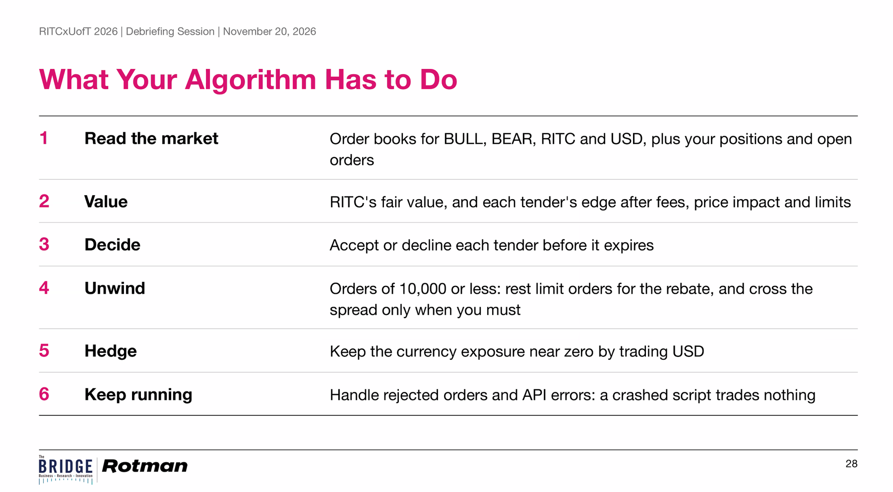
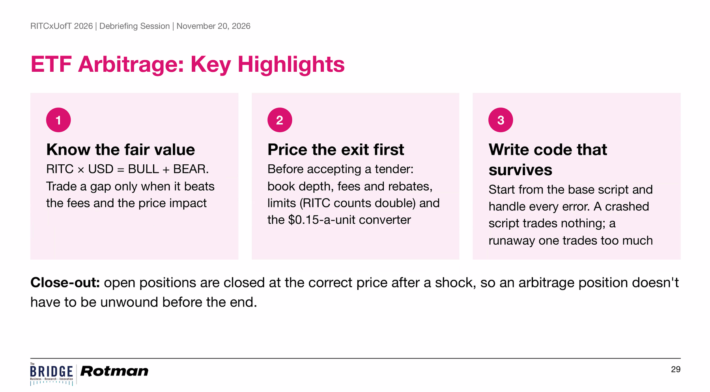
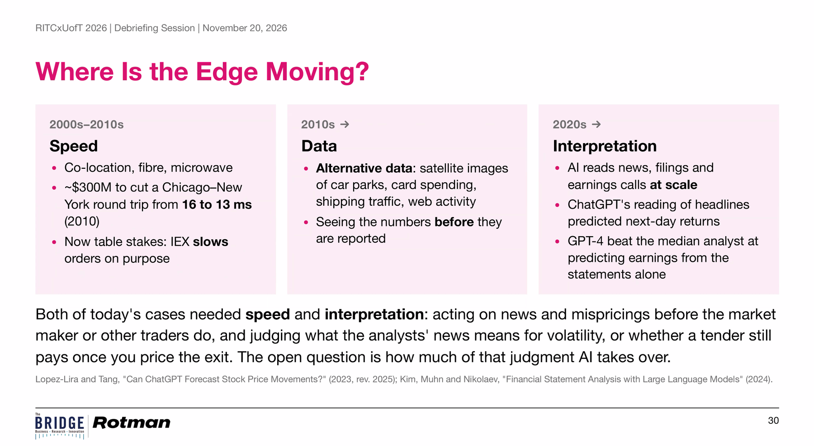

# RITCxUofT 2026 case debrief

The November 20, 2026 debrief from The BRIDGE and Rotman covered two ways to trade a temporary pricing gap. In the options case, analyst releases gave traders an earlier estimate of RTM volatility. In the ETF case, BULL, BEAR and the exchange rate gave traders a reference value for RITC. Each case then required estimating what the trade would earn after execution costs and managing the resulting exposure.

- [Options volatility](#options-volatility)
- [ETF arbitrage](#etf-arbitrage)
- [How the trading edge is evolving](#how-the-trading-edge-is-evolving)

The slide images come from the organizers’ debrief. The explanations connect them to the published [case rules](sources.md) and the [strategies in this repository](algorithms.md).

## Options volatility

### Analyst updates lead the market maker

The market maker quotes RTM options using Black–Scholes. After a volatility shock, the analyst forecast updates ahead of the volatility reflected in those quotes. The chart illustrates three changes over four simulated weeks. After the first upward shock, the market maker’s implied volatility is below the analysts’ estimate, so the strategy looks to buy options. After the downward shock, implied volatility is above the estimate, so the strategy looks to sell. The gap is widest soon after a shock and shrinks as the market maker updates its estimate.

To compare the forecast with an actual trade, value the option at the forecast volatility and compare that value with the **ask for a buy** or the **bid for a sell**. A midpoint can make the opportunity look larger than it is. The buffered bot uses the low end of the analyst range for buys and the high end for sells, then deducts fees and reserves for exit and hedging costs. It weights the current and announced future weeks by their contribution to remaining variance.

### Delta hedging and put–call parity

**Hedge the first-order exposure to RTM.** Each option contract covers 100 shares. For example, ten long calls with a delta of 0.55 create about +550 delta units. Selling 550 RTM shares would bring the position’s initial delta near zero. Delta changes as RTM moves and time passes, so the hedge has to be recalculated. The case allows portfolio delta from −7,000 to +7,000. The bot uses tighter internal limits to leave room for price moves between updates.

**Check the call and put as a package.** For European options on the same non-dividend-paying underlying with the same strike and expiry, put–call parity at a 0% rate is `C − P = S − K`. Here `S` is the RTM price and `K` is the strike. At a nonzero rate, discount the strike. Check the package with executable bids and asks for the call, put and stock, then deduct transaction costs. The repository logs qualifying discrepancies through `parity_scan`. Its orders come from the volatility strategy and its hedge.

## ETF arbitrage

### Convert the basket to the ETF’s currency

One RITC unit represents one BULL share and one BEAR share. BULL and BEAR trade in CAD, RITC trades in USD, and the `USD` instrument quotes **CAD per USD**. The basket’s net asset value per ETF unit is therefore `(BULL + BEAR) ÷ USD` in USD.

With BULL at CAD 10.20, BEAR at CAD 14.90 and FX at 1.0040 CAD per USD, fair value is `25.10 ÷ 1.0040 = USD 25.00`. RITC at USD 25.12 is rich by USD 0.12 per unit before costs. The corresponding basket trade sells RITC and buys both stocks. A cheap RITC reverses those legs. Trading the USD exposure keeps exchange-rate moves from dominating the intended price convergence. The bot uses executable equity and FX quotes for basket entries, so an apparent gap must survive spreads and fees.

### Price the exit before accepting a tender

Buying 20,000 units at USD 24.88 against USD 25.00 fair value gives **USD 2,400 of gross edge**. A direct market exit charges `20,000 × USD 0.02 = USD 400`, leaving **USD 2,000 before price impact** if the whole position could sell at fair value. The 10,000-unit order cap requires at least two orders. Estimate the average fill price by walking the bids at the size you need to sell. Resting limit orders can earn the case’s USD 0.01 per-unit rebate when they fill, with the risk that inventory remains exposed while they rest.

A manual redemption costs `USD 1,500 ÷ 10,000 = USD 0.15` per unit. Two redemptions would cost USD 3,000, which exceeds the theoretical edge by USD 600 before selling the stocks. A thin ETF book can still make redemption cheaper than a direct exit. The official rules reserve the converter for manual use in the RIT Client. The bot uses market execution and exchange settlement.

RITC carries a published weight of two. From a flat position, accepting the example consumes **40,000 weighted units** of both gross and net capacity. With positions already open, compute the post-tender limits from the whole portfolio and include possible fills from outstanding orders.

### From market data to a reconciled position

Use the BULL, BEAR, RITC and USD order books together with positions, open orders and tender expiry. An attractive tender needs enough edge after estimated exit costs and enough room under the limits. The bot rechecks the book and account before acceptance. It prices tenders using both NAV and the current RITC midpoint, then reduces inventory over a declining schedule using market clips and resting limit orders. The separate basket strategy prices the full trading package at executable quotes.

After submission, use confirmed fills and updated positions to size the next equity or FX trade. A partial fill changes both the remaining inventory and the required hedge. The bot cancels and reconciles outstanding quantities before replacing them. It stops for reconciliation when the outcome of a submission is uncertain.

### Settlement sets the final exit value

The simulator closes remaining positions at the last traded price or at a corrected value when a shock causes a divergence. That rule allows a basket arbitrage position to carry through expiry. A tender still creates inventory, FX exposure and position-limit usage during the heat. The default ETF strategy works the inventory down and reconciles any residual positions, orders and net liquidation value at settlement.

## How the trading edge is evolving

The debrief traces three sources of advantage. Co-location, fibre and microwave links reduce reaction time. Alternative data such as card spending and shipping traffic can reveal changes before they appear in company reports. Language models can process news, filings and earnings calls at scale. In the simulation, speed mattered right after a volatility shock or when a tender appeared. Interpretation determined what the news implied for option prices and whether a tender still paid after the exit.

The slide cites research on GPT-4’s ability to score headlines associated with subsequent equity returns and to predict the direction of earnings changes from standardized financial statements. [López-Lira and Tang](https://arxiv.org/abs/2304.07619) · [Kim, Muhn and Nikolaev](https://arxiv.org/abs/2407.17866)
