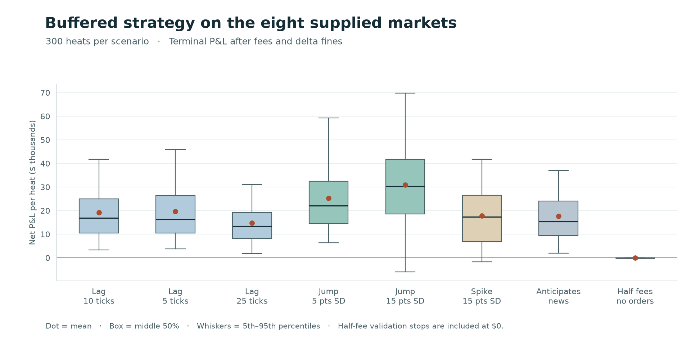
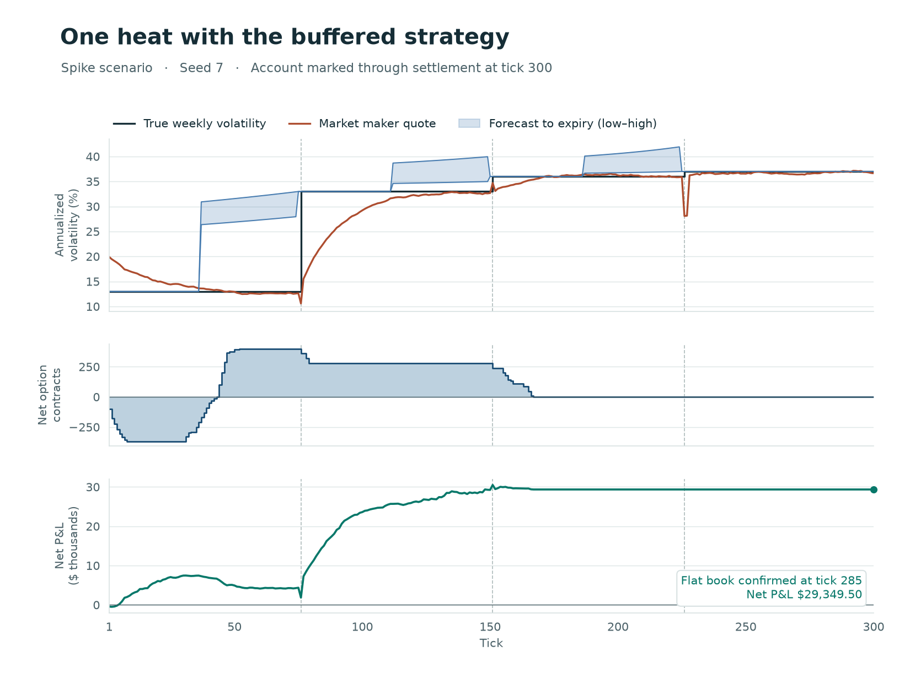

# RITCx volatility case | Buffered strategy replay

**Mean simulated net P&L was $18,170.18 per heat** when each of the eight supplied scenarios received equal weight. Under the published fee schedule, the mean was **$20,765.92** across seven scenarios, with individual scenario means from **$14,807.15 to $30,954.32**. The repository's own case simulator produced **$15,933.44** per heat on its separate 100-seed benchmark. Live competition P&L is unknown.

## Results on the supplied simulator

| Maker and fee assumption | Heats | Mean net P&L | Median | Worst heat | Losing heats | Mean fees | Mean delta fines |
|---|---:|---:|---:|---:|---:|---:|---:|
| Lag with 10-tick half-life | 300 | $19,241.02 | $16,863.25 | −$384.80 | 1 | $4,680.16 | $0.22 |
| Lag with 5-tick half-life | 300 | $19,578.05 | $16,294.17 | −$1,088.31 | 2 | $4,577.64 | $0.70 |
| Lag with 25-tick half-life | 300 | $14,807.15 | $13,375.45 | −$2,428.77 | 6 | $4,527.69 | $2.30 |
| Week-start jump, 5-point standard deviation | 300 | $25,336.56 | $22,140.97 | −$6,257.02 | 1 | $4,719.25 | $29.54 |
| Week-start jump, 15-point standard deviation | 300 | $30,954.32 | $30,369.75 | −$18,636.54 | 27 | $5,198.59 | $23.46 |
| One- or two-tick spike, 15-point standard deviation | 300 | $17,814.86 | $17,341.05 | −$5,668.48 | 28 | $4,424.20 | $5.96 |
| Maker partly anticipates the forecast | 300 | $17,629.51 | $15,357.91 | −$851.76 | 1 | $3,938.48 | $0.00 |
| 10-tick lag with half fees | 300 | $0.00 | $0.00 | $0.00 | 0 | $0.00 | $0.00 |

The replay used seeds 1–300 in each scenario, for 2,400 outcomes over 300 underlying paths. The aggregate terminal P&L was **$43,608,433.58** over separately initialized accounts. Each heat starts flat at $0 and the simulator deducts fees and delta fines. The full-fee median was $17,975.00, with 66 losing heats (3.14% of full-fee runs). The worst individual heat lost $18,636.54. All 2,100 full-fee runs confirmed flat before expiry, with zero order rejections. All 300 half-fee runs stopped before their first order because the current trader requires $2 per option contract and $0.02 per RTM share.



## What the current code trades

The launcher selects `buffered`. On each decision it prices the ten RTM calls and puts over strikes 48–52. It builds a range of Black–Scholes values from time-weighted remaining variance. For weeks beyond the latest announcement it carries forward the latest available news range. A buy uses the low fair value against the ask. A sale uses the high fair value against the bid. Entry requires more than $0.04 per share of remaining edge after a reserve for option commissions, the exit spread and stock hedging.

The bot chooses the leg with the largest edge times admissible quantity. Each entry can reach 100 contracts, subject to caps of 1,000 gross options, 800 net options and 45,000 RTM shares. New entries use 75% of the stressed-delta allowance. The ordinary RTM hedge triggers at 1,200 shares of delta, and an option fill triggers an immediate hedge based on confirmed inventory.

The bot reduces positions as the edge erodes or risk limits bind. New entries end at tick 270. Liquidation can begin earlier when the remaining inventory needs more time to close or the heat's marked loss reaches $6,000. That loss level triggers an exit and can be exceeded.

## One heat

On spike scenario seed 7, the strategy ended at **$29,349.50**. The shaded band shows the low and high forecasts used for option valuation. Net option contracts are signed across strikes and option types. The bottom panel marks the account through tick 300.



## Replay conditions

The adapter runs the checkout's volatility bot entry point with its default policy. The supplied simulator generates the same weekly volatility paths, news, quotes, fills, fees, pre-decision delta fines and final settlement as its published replay. Requests within a tick take zero simulated time, and the bot gets one decision per tick. The adapter maps the simulator's stock and option limit names to the names the bot validates and turns immediate fills into order receipts for production reconciliation. The simulated exchange calculates account value. Hidden weekly volatility is used only by the exchange and the trace chart.

Every assumed market receives equal weight in the aggregate. Actual competition frequencies, maker behavior and request latency are unknown. In the repository's separate 100-heat `case` benchmark, requests take 40–80 simulated milliseconds, week-one volatility starts at 20%, and the maker's lag and the analyst forecasts follow different distributions. Rerunning the 100 seeds reproduced every saved per-heat result. Their total was $1,593,344.47, with a $13,523.52 median, one loss of $194.84 and four $0 outcomes. Both experiments measure the volatility case alone.

## Reproduce

From the RITCxUofT checkout, point the replay at the extracted research bundle. The command runs all eight scenarios on seeds 1–300.

```sh
python3 tools/replay_volatility.py --bundle ~/Downloads/ritcx-vol-algo --seeds 300 --workers 8
```

[All 2,400 outcomes, trace and source hashes](results.json) · [Replay adapter](../../tools/replay_volatility.py) · [Production decision logic](../../ritcx/volatility/buffered.py) · [Policy and fees](../../ritcx/volatility/bot.py) · [Repository case benchmark](../volatility-buffered-only-validation-2026-11-19.json)
